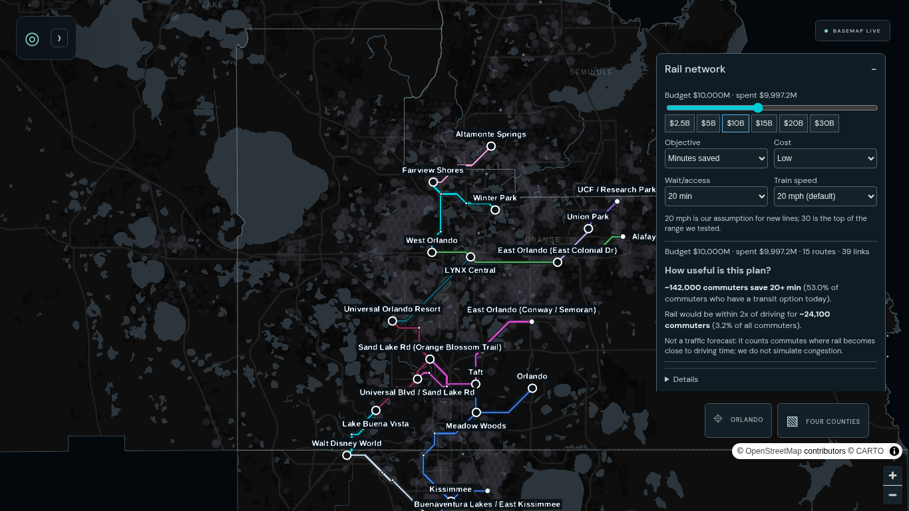
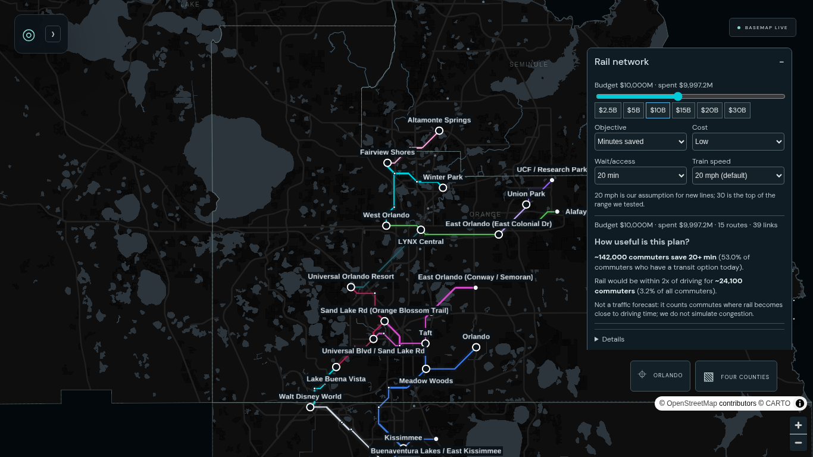

# SOL/R

SOL/R is an interactive map for exploring where new rail could serve Orlando and Orange, Seminole, Lake and Osceola counties under a budget. This UCF COP4283 final project combines workplace commute flows, existing transit travel times and a connected-network planner. It lets readers compare assumptions and inspect the resulting build order. It is not a ridership or traffic forecast, an engineering study, or a recommendation to construct the drawn lines.




Map data © OpenStreetMap contributors, basemap © CARTO.

## What you can do in the app

Enable **Proposed rail network**, then use its accordion panel. Settings are assumptions, not estimates of how a future railway would operate.

| Setting | Choices |
| --- | --- |
| Budget | $0–$30B, default $10B; published comparison budgets $2.5B, $5B, $10B, $15B, $20B and $30B, plus completed-build-step stops |
| Objective | Minutes saved versus existing transit, or workers newly connected; never combined |
| Construction cost | Low / high |
| Wait/access overhead | 10 / 20 / 30 minutes per trip |
| New-line speed | 20 mph default / 30 mph tested; existing rail times stay fixed |
| Newly connected threshold | Rail time at most 1.5 / 2 / 3 times driving time |
| Drawing | Schematic / Geographic; neither changes the analysis |

- **How useful is this plan?** shows commuters saving 20+ minutes and trips within 2× driving time. Details adds cumulative 10+/20+/30+ bars, the 1.5× comparison, top improved commutes and **Pick a commute**. Selecting a pair highlights its rail path. Counts labeled “commuters” represent jobs, not unique people or predicted riders.
- **Lines**, **Build order** and **Core network only** explain what gets built. Budget is a limit; actual spending can be lower. Named lines keep their colors as the budget changes.
- **Who does this serve?** compares household, no-vehicle and poverty reach, plus income, at 0.8 km and 2 km. Equity is separate from commute scores. The committed equity export covers the 24 original 20 mph scenarios; missing 30 mph results are shown as unavailable.
- **Sunshine Corridor (FDOT proposal)** is an independent light-red schematic overlay traced from the FDOT study figure. Its drawn 3B/3C segments are a reference, not model-selected or surveyed routes.
- **Population**, **Employment** and **Equity** show modeled population, workplace jobs and ACS need indicators. Population has quiet 2D circles and 3D needles; its 2D opacity dims automatically with rail and can be overridden in its display settings. Employment remains independently inspectable. Population's 3D columns are hidden while Rail network is open unless **Show population** is checked.
- **Candidate connections** and **Top commute flows** expose the underlying centers and large commute pairs. Place names are editorial labels. Existing SunRail/Brightline and LYNX layers provide context; optional train motion is illustrative, not real schedules.

Controls and inspection panels share one scrolling accordion. Keyboard selectors provide access to features whose map labels are hidden to avoid collisions. The app supports flat and pitched views and reduced-motion preferences.

## How the analysis works

1. **Prepare commute demand.** [`od.py`](analysis/rail/od.py) assigns 2023 Florida LODES home/work blocks to H3 resolution-8 cells using Census internal points. Both ends must lie in the four counties. The authoritative [`lodes_od_hex8_2023.csv`](data/processed/lodes_od_hex8_2023.csv) contains 591,177 pairs and 1,006,088 jobs.
2. **Find activity centers.** [`centers.py`](analysis/rail/centers.py) clusters adjacent cells in the top 5% by workplace jobs or modeled population, producing 146 centers. Jobs come from LODES WAC, population from Kontur. Each center connects to up to three nearest centers within 40 km. This initial candidate set is independent of transit plans; the later planner adds explicit hub connections and the documented Sunshine 3A candidate.
3. **Establish travel-time baselines.** [`baseline_times.py`](analysis/rail/baseline_times.py) uses r5py with LYNX, SunRail and Brightline GTFS and a clipped Florida OpenStreetMap extract. The departure is November 4, 2026 at 08:00, intended as America/New_York time. The completed run's OSM extract date is **not recorded**. [`center_od.py`](analysis/rail/center_od.py) aggregates routed hexagon-pair times to centers, using a default 5 km assignment radius and 3/8 km sensitivity cases; access distance is recorded but not charged as time.
4. **Price and time candidate links.** [`links.py`](analysis/rail/links.py) matches candidates to existing rail geometry; [`rail_params.py`](analysis/rail/rail_params.py) holds planning-level passenger-corridor costs of $4.4–10.9M/mile, freight-corridor costs of $30.9–51.1M/mile and new-alignment costs of $119–223M/mile. Corridor lengths/circuity inform costs and times even though map links are straight or schematic. New links use the selected speed, with one trip-level overhead.
5. **Include existing rail.** [`stations.py`](analysis/rail/stations.py) and [`network.py`](analysis/rail/network.py) merge nearby centers into station nodes, including SunRail and Brightline at MCO. Existing SunRail links have zero **construction cost**, not zero travel time or fare. [`demand.py`](analysis/rail/demand.py) and [`score.py`](analysis/rail/score.py) keep time savings and new connections separate; planner gains are marginal to the existing rail network.
6. **Grow a connected network.** [`run_network.py`](analysis/rail/run_network.py), [`routes.py`](analysis/rail/routes.py) and [`routegreedy.py`](analysis/rail/routegreedy.py) buy anchor-to-anchor routes by marginal gain per dollar, allowing loops. Greedy selection is not a proven optimum. The two speeds yield 48 scenarios: two cost cases × three overheads × four objective/ratio combinations × two speeds.
7. **Export and inspect.** [`export_network.py`](analysis/rail/export_network.py) writes [`public/data/rail_network.json`](public/data/rail_network.json), including usefulness summaries. [`lines.py`](analysis/rail/lines.py) groups links by straightest continuation into named map lines. [`run_equity_network.py`](analysis/rail/run_equity_network.py) writes a separate equity analysis; the frontend reads [`public/data/rail_equity_v2.json`](public/data/rail_equity_v2.json).

See [data contracts](data/) for schemas and reconciliation, and [model assumptions](docs/rail-model-assumptions.md) for the design history and unresolved evidence gaps.

## Key findings under the model's assumptions

These are results in the committed exports, not forecasts. The base case is **low cost, 20-minute overhead, minutes saved, 20 mph** at a **$10B budget**.

- The base case builds **15 routes, 39 links and 10 visible named lines**, spending **$9.9972B**. **142,026** modeled commuters save at least 20 minutes, or **53.0% of 267,793** with a transit option in the modeled demand. This count rises to **162,292 at $15B** and **175,710 at $30B**: gains diminish after roughly $10–15B rather than reaching a hard ceiling.
- Driving competitiveness remains low. At $10B, rail is within **2× driving for 24,095 of 763,549 modeled commuters (3.2%)**, and within **1.5× for 1,937 (0.25%)**. With 30 mph and otherwise the same assumptions, the counts are **61,268 (8.0%)** and **5,352 (0.7%)**. At $30B and 30 mph, **136,353 (17.9%)** meet the 2× comparison. This gives limited grounds to expect broad traffic relief; it does **not** establish how much traffic would change. There is no congestion or mode-choice simulation.
- At $10B and 20 mph, the equity screen reaches **16.3% of households and 21.0% of no-vehicle households** at 2 km, versus **7.7% of households** for existing stations. “Reached” means the **tract centroid** lies within the radius; it is not a count of homes with a walkable path. Equity is never added to commute scores.
- **Sunshine 3A, Meadow Woods–MCO**, is a documented candidate of **5.5 miles and $400M** in [`hub_links.py`](analysis/rail/hub_links.py), citing the FDOT TCAR and 2018 OIA study. No build step selects it in any of the **24 original 20 mph scenarios**, across either commute objective. Airport passenger and tourist trips are absent from the commute demand; non-selection is not an evaluation of those markets.

The 763,549 comparison base equals the export's 267,793 jobs with transit plus 495,756 without transit. The app uses this base rather than summing its smaller commute-picker extract. It is not the entire regional workforce.

## Limitations and assumptions

- LODES counts **jobs, not unique people**. Confidentiality noise affects small flows, and a large employer's jobs can be concentrated at one workplace location.
- Only jobs with both home and work inside the four counties enter the OD model: **1,006,088 of 1,467,549 jobs located there**. About **31%** have home ends outside the region and are excluded.
- Scoring drops trips within one center or a merged station area. Other assignment, missing-time and routing-limit rules also narrow the modeled demand.
- All assigned workers in a station's center are treated as served. This can overstate access: the separate 2 km equity screen reaches only about 16% of households in the base plan, and even that is a tract-centroid approximation.
- There is no separate transfer penalty. The 10/20/30-minute overhead stands in for waiting and access; its decomposition into headway, access and transfer costs is not calibrated or sourced. Workers-connected results depend strongly on overhead and the competitiveness ratio.
- “Minutes saved versus transit” compares available travel options, **not observed transit users**. LODES does not identify current travel mode, so the share of beneficiaries actually riding transit is unknown.
- Driving is free-flow, without congestion, which can make rail compare less favorably. Parking, fuel costs and reliability are not modeled. Benefits for households without cars are reported through equity, not a combined score.
- The baseline is one fall-2026 schedule snapshot. Blank router times do not prove no route exists; search limits, snapping and the clipped map extent matter. The Brightline feed's Event Train agency was not separated out.
- Links are not surveyed alignments. Corridor matching, candidate centers, hub additions and station snapping are assumptions. Matches such as Conway and Taft need geographic review; they are not confirmed station sites.
- Generic costs are planning-level and exclude stations, vehicles and station access; source dollar years are not fully harmonized. The documented **3A cost is an exception**, including right of way and trainsets. Comparing it with generic link costs is imperfect.
- The Sunshine overlay is schematic, its Meadow Woods junction is inferred, and its 3B/3C segments have no commute scores. Neither this comparison nor the greedy build order establishes a preferred public project.
- ACS estimates carry sampling error; tract-level values do not vary within a tract. Kontur population is a **modeled estimate, not a measured count**.

## Data sources and rights

[Data sources and provenance](docs/DATA_SOURCES.md) records filenames, vintages, hashes where available, processing and missing provenance. Principal sources are:

- [Census LODES](https://lehd.ces.census.gov/data/) 8.4, 2023 OD and WAC jobs, and [ACS](https://www.census.gov/programs-surveys/acs) 2020–2024 population/equity estimates: public-domain US Census data.
- [Kontur Population](https://data.humdata.org/organization/kontur), release 2023-11-01: modeled H3 population, CC BY attribution.
- [LYNX GTFS](http://gtfsrt.golynx.com/gtfsrt/google_transit.zip), [SunRail GTFS](https://corporate.sunrail.com/about-sunrail/gtfs-data-download/) and [Brightline GTFS](http://feed.gobrightline.com/bl_gtfs.zip): agency terms apply; no blanket open license is recorded. Brightline acquisition also credits [Transitland](https://www.transit.land/).
- [OpenStreetMap contributors](https://www.openstreetmap.org/copyright): ODbL; the routing extract was supplied through Geofabrik. [CARTO](https://carto.com/attributions) supplies the dark basemap.
- **FDOT Sunshine Corridor TCAR Final Report (2024), Tables 13–15 and study-area figure**, and **SunRail Extension to OIA PD&E Study (2018)**: sources cited in the repository for the traced overlay and 3A candidate. Report URLs and a figure-reuse license are not recorded; these materials are not relicensed as project code.

## Run it

### Frontend

Use **Node 22.12+** and npm. The committed `public/data/` exports let the map run without Python, a backend or an API key.

```sh
npm ci
npm run dev -- --host 0.0.0.0
```

Open the local URL printed by Vite. A WebGL-capable browser and network access to CARTO's basemap resources are required; optional Google Fonts fall back to system fonts. Basemap/network failures are shown in the UI.

```sh
npm run lint
npm run check
npm run test:usefulness
npm run build
npm run preview -- --host 0.0.0.0
```

For browser tests, keep the dev server running in another terminal and install Playwright Chromium once:

```sh
npx playwright install chromium
npm run test:smoke
npm run test:population
npm run test:transit
npm run test:hexagons
npm run test:employment
npm run test:equity
npm run test:lynx
npm run test:train-motion
npm run test:candidates
npm run test:flows
npm run test:rail-plan
npm run test:sunshine
```

`PLAYWRIGHT_CHROMIUM_EXECUTABLE_PATH` can select an already-installed Chromium. Smoke suites use a controlled basemap fixture; they do not verify live tile availability. Vitest checks the browser router against exported reference ride times as well as speed selection and formatting.

### Analysis

Run modules from the repository root. `python` below means the interpreter for the chosen environment; on Windows, `py -3.14` can be substituted. Scoring, corridor classification, network planning, named-line export and equity calculations use only the **Python standard library**. Data preparation additionally needs **h3 and dbfread**:

```sh
python -m pip install -r analysis/rail/requirements.txt
# The legacy OD fixture in this discovery command also requires GDAL/OGR.
python -m unittest discover -s analysis -p "test_rail*.py"
```

The requested rail-pattern test command still includes one legacy OD fixture that imports **GDAL/OGR**. It will fail without those bindings even though the OD reader and rail model are GDAL-free. For the model/center tests without that legacy fixture, use `python -m unittest discover -s analysis/rail -t . -p "test_rail*.py"`. The broader `python -m unittest discover -s analysis -p "test_*.py"` also requires GDAL for older county/tract preparation.

Data-preparation entry points (these may download source files or write outputs; they are not needed to view the app):

```sh
python -m analysis.rail.od --verify-only
python -m analysis.rail.centers
python -m analysis.rail.center_od
```

`od --verify-only` downloads/caches the Census sources and checks the authoritative uncompressed reference without replacing it. Without that flag, OD writes `data/processed/lodes_od_hex8_2023.csv.gz` only after reconciliation. `centers` writes `candidate_centers.geojson`, `candidate_connections.geojson` and `candidate_connections_summary.json` in `data/processed/`. `center_od` writes `center_od_baseline.csv.gz`, `center_hex_access.csv.gz`, `center_od_unassigned.csv` and `center_od_sensitivity.json` there.

Routing needs a separate environment:

```sh
python -m pip install -r analysis/rail/requirements-routing.txt
python -m analysis.rail.baseline_times
```

That command is **Colab-configured, not ready to run on an arbitrary checkout**: first supply the GTFS/OSM inputs and the mounted storage expected by `DRIVE` in the script. It requires Java 21+, r5py, geopandas, h3, shapely and pandas; routing dependency versions are unpinned. It saves batches and writes `data/processed/baseline_travel_times.csv.gz`. Full routing is slow, particularly driving. See the [baseline contract](data/BASELINE_TRAVEL_TIMES_CONTRACT.md); the committed baseline can be reused without rerouting.

With the committed preparation inputs, the current model commands are:

```sh
python -m analysis.rail.links
python -m analysis.rail.run_network
python -m analysis.rail.run_network --grid
python -m analysis.rail.run_network --grid30
python -m analysis.rail.export_network
python -m analysis.rail.run_equity_network
```

- `links` writes `data/processed/link_classes.csv` from the candidate connections, rail geometry and passenger shapes.
- `run_network` prints a base-case comparison; `--grid` writes `data/processed/rail_scenarios_v2.json`, and `--grid30` writes `rail_scenarios_v2_s30.json`. Each grid evaluates 24 scenarios and can take minutes. The current `--grid` entry point also prints the base comparison after writing its grid.
- `export_network` reads both grids and the existing preparation files, including legacy `public/data/rail_plan.json`, then writes `public/data/rail_network.json` and computes usefulness summaries. It does not recreate all upstream inputs.
- `run_equity_network` reads the network, ACS tract data and raw ACS population input; it writes **`data/processed/rail_equity_v2.json`**. Publishing it to `public/data/` is a separate reviewed copy, not automatic. Recomputing against the current network would cover 48 scenarios; the committed frontend equity file contains 24.

`stations.py` is an upstream helper, not a portable no-argument setup command: supply the plan JSON and the two extracted GTFS `stops.txt` paths as its three positional arguments. Raw feeds, map extracts and routing chunks are not all distributed with the repository. Contracts document required inputs; do not assume that a fresh checkout can regenerate the entire pipeline without obtaining them.

## Repository map

```text
src/                 React controls, data adapters and MapLibre/deck.gl rendering
analysis/rail/       Demand preparation, routing, scoring, planner and exports
data/processed/     Prepared analytical inputs and outputs
public/data/         Browser-delivered exports
data/                Data contracts and editorial center labels
scripts/             Node adapter tests and Playwright smoke checks
docs/                Provenance, assumptions and screenshots
```

## Credits and status

A UCF COP4283 student project, built with **Codex-assisted development and Claude-assisted analysis**. The connected-network planner and interactive comparison are implemented; provenance gaps, service assumptions and geographic validation remain limitations rather than completed engineering work.

[GitHub Actions CI](.github/workflows/ci.yml) runs lint, Vitest usefulness tests, TypeScript and the production build on pull requests to `main` and pushes to `main`. Browser suites and Python tests are separate checks, not part of that workflow. ESLint currently covers selected rail/usefulness modules, not the entire legacy application.

For Vercel, the build command is `npm run build` and the static output directory is `dist`. No live-site URL or Vercel deployment configuration is recorded in the repository; these are deployment settings, not confirmation of a running deployment.

## License

Project code is available under the [MIT License](LICENSE). Data and map content retain their own rights: OpenStreetMap contributors under ODbL; LODES and ACS public domain; Kontur attribution under CC BY; GTFS per agency terms; and FDOT Sunshine Corridor figures cited as the source of the traced overlay. The MIT license does not grant rights to third-party datasets, tiles or report figures.
